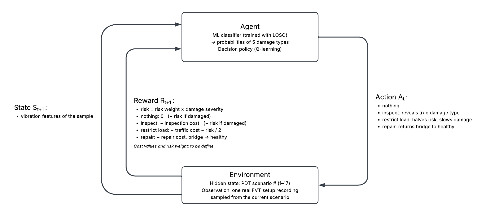

## Clone the repository

```
git clone https://github.com/rodolphe-reynard/291Dproject.git
```

## Build the environment

```
uv sync
```

**If you also want to run .ipynb files:**

```
uv sync --all-extras
```

## Current architecture


